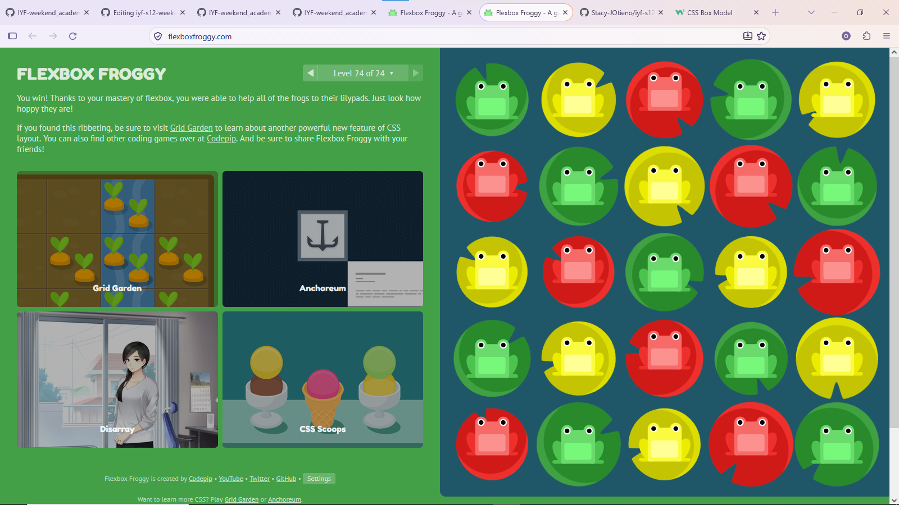

# Week {Number}: {Project Title}

## Author
- **Name:** Stacy Otieno
- **GitHub:** [@StacyJOtieno](https://github.com/Stacy-JOtieno)
- **Date:** November 1, 2026

## Project Description
This project focuses on learning and practising CSS Flexbox and CSS Grid layouts. I explored how to arrange, align, and organise elements on a webpage to create responsive and well-structured designs.

I also used Flexbox Froggy and Grid Garden to practise these layout techniques through interactive exercises.

## Technologies Used
- HTML5
- CSS3
- Visual Studio Code
- Flexbox Froggy
- Grid Garden

## Features
- Practised arranging elements using CSS Flexbox.
- Explored two-dimensional layouts using CSS Grid.
- Learned how to align, distribute, and reorder elements.
- Practised responsive layout techniques.

## How to Run
1.Clone this repository.
2. Open the project folder in Visual Studio Code.
3. Locate index.html.
4. Open it in your browser or use the Live Server extension.

## Lessons Learned
Designing a web using:
- flex-direction
- flex-wrap
- justify-content
- align-content
- flex-flow
- order
I also practised CSS Grid through Grid Garden and learned how to organise webpage elements using rows and columns.

## Challenges Faced
I experienced challenges when merging branches and pushing changes to GitHub. Through troubleshooting, I learned more about Git commands, branch management, and resolving GitHub workflow issues.

## Screenshots (optional)

(Grid Garden)(https://github.com/Stacy-JOtieno/iyf-s12-week-02-Stacy-JOtieno/blob/main/grid-garden.png)

## Live Demo (if deployed)
[View Live Demo](https://stacy-jotieno.github.io/iyf-s12-week-02-Stacy-JOtieno/)
